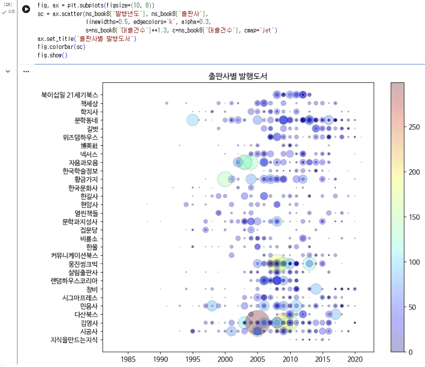
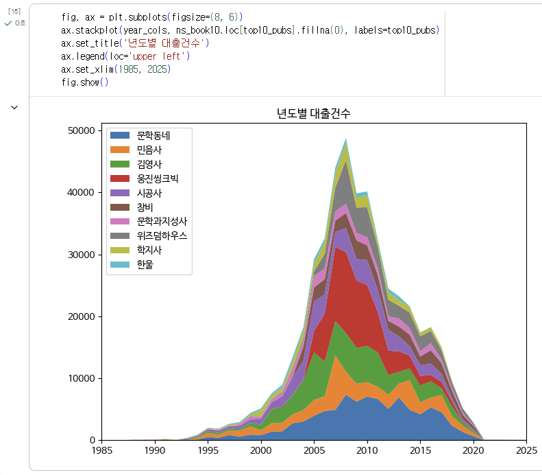
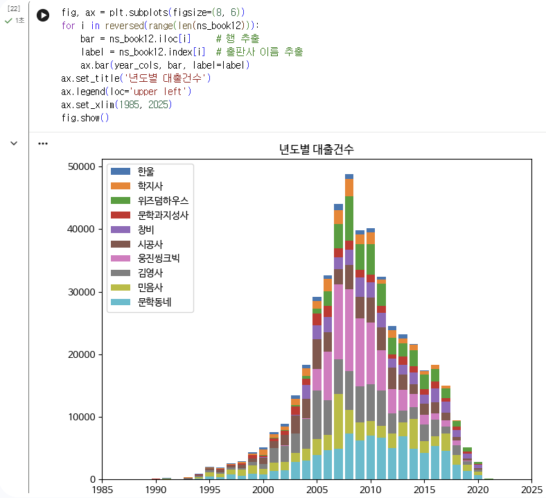
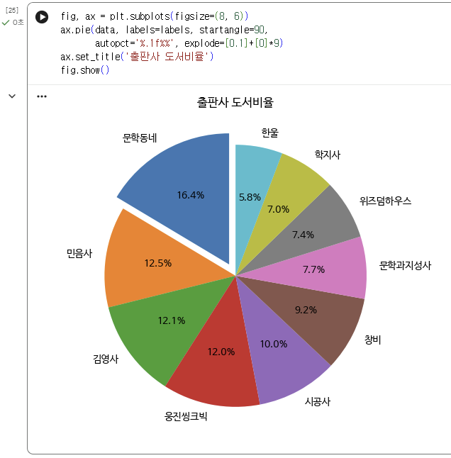

# 데이터분석 6주차 정규과제

📌데이터분석 정규과제는 매주 정해진 분량의 『*혼자 공부하는 데이터 분석 with 파이썬*』 을 읽고 학습하는 것입니다. 이번 주는 아래의 **DataAnalysis_6th_TIL**에 나열된 분량을 읽고 공부하시면 됩니다.

아래의 문제를 풀어보며 학습 내용을 점검하세요. 문제를 해결하는 과정에서 개념을 스스로 정리하고, 필요한 경우 제시된 강의를 참고하여 보완하는 것이 좋습니다.

<!-- 강의 링크는 아래와 같습니다.
https://www.youtube.com/watch?v=XD65UhBMOiI&list=PLVsNizTWUw7FGzSRCkQrPEEe-ljVXgS7k&index=12
https://www.youtube.com/watch?v=NTQ5NXelOfw&list=PLVsNizTWUw7FGzSRCkQrPEEe-ljVXgS7k&index=13
-->


## DataAnalysis_6th_TIL

### 6장 복잡한 데이터 표현하기
#### 01. 객체지향 API로 그래프 꾸미기
#### 02. 맷플롯립의 고급 기능 배우기


## Study Schedule

| 주차  | 공부 범위     | 완료 여부 |
| ----- | ------------- | --------- |
| 1주차 | p.24~81    | ✅         |
| 2주차 | p.84~151   | ✅         |
| 3주차 | p.154~219  | ✅         |
| 4주차 | p.222~279 | ✅         |
| 5주차 | p.282~325 | ✅         |
| 6주차 | p.328~379 | ✅         |
| 7주차 | p.382~430 | 🍽️         |

<br>

<!-- 여기까진 그대로 둬 주세요-->


# 1️⃣ 개념 정리 

## 01. 객체지향 API로 그래프 꾸미기

matplotlib의 그래프 그리는 방식에는 matplotlib아래에 있는 함수를 사용하는 pyplot 방식과 subplots() 함수 등을 사용해서 명시적으로 피겨 객체와 Axes 객체를 만들고, 그 Axes 객체의 메서드를 호출하는 객체지향 API 방식이 있다. pyplot 방식의 함수 이름과 객체지향 API의 메서드 이름 사이에는 어느 정도 유사성이 있다. 

한글로 그래프의 제목이나 내용을 표시할 수 있다. s 매개변수로 산점도에서 모든 데이터의 특정 속성에 따라 마커 크기를 서로 다르게 할 수 있다. 산점도를 x축, y축, 마커 크기까지 세 가지 속성으로 데이터를 표현하는 효과를 가질 수 있다. 

linewidths는 기본값이 1.5이고, 마커 테두리의 두께를 지정한다. edgecolors는 기본적으로 마커 색과 테두리 색이 동일한데, 이를 다르게 지정하면 인접한 마커들끼리 경계를 더 잘 구분할 수 있다. alpha는 투명도를 지정할 수 있다. c 매개변수를 사용하여 마커의 색깔도 데이터 값에 따라 다르게 표현할 수 있다. 색상이 자동으로 변하는 것을 컬러맵이라고 하고, 기본 컬러맵은 viridis이다. cmap 매개변수로 다른 컬러맵을 지정할 수 있으며, 자주 사용하는 컬러맵은 jet 컬러맵이다. 색깔이 실제 어떤 값에 해당하는지 보여주는 컬러 막대를 그래프에 추가할 수 있다. 

## 02. 맷플롯립의 고급 기능 배우기

plot() 함수를 여러 번 호출하면 하나의 Axes 객체(한 화면) 안에 여러 개의 그래프를 함께 그릴 수 있다. 색깔을 따로 지정하지 않으면 matplotlib이 자동으로 색을 돌아가며 지정해준다. plot() 호출 시 label 매개변수로 각 선의 이름을 지정하고, 마지막에 legend() 메서드를 호출하면 그려준다. 범례는 그래프 안에서 여백이 많은 적절한 위치에 자동으로 배치된다. 여러 개의 선을 반복해서 그릴 때는 for문을 사용하여 그릴 수 있다. 특정 구간에 데이터가 몰려 있을 때, x축/y축의 범위를 지정하여 특정 구간만 보이도록 조절할 수 있다. 

stackplot으로 여러 선그래프의 아래 면적이 쌓이는 형태로 stack 그래프를 그릴 수 있다. stack 그래프는 각 데이터가 차지하는 비율을 더 쉽게 파악할 수 있다. 이를 위해 피벗테이블을 활용해서 원본 데이터를 각 행이 항목, 각 열이 연도가 되는 형태로 변환하는 작업이 필요하다. 데이터에 NaN값이 있으면 그래프가 잘못 그려지는 경우가 있어 미리 결측값을 0으로 채워주는 것이 안전하다. 

막대그래프(bar)를 여러 번 호출하는 방식은 선그래프와 비슷하지만 막대는 색이 채워지기 때문에 그냥 여러 번 호출하면 나중에 그린 막대가 먼저 그린 막대를 덮어씌우는 문제가 있다. 각 막대의 두께를 줄여서 서로 겹치지 않고 나란히 보이도록 할 수 있지만 종류가 많아지면 막대가 너무 얇아지고, 전체적으로 비교하기 어렵다. 또는 stack 그래프를 그릴 수 있다. bottom 매개변수를 사용하여 막대가 시작되는 y축 위치를 지정하고, 이전에 그린 막대의 높이를 다음 막대의 시작 위치로 지정하면 서로 겹치지 않고 쌓이게 된다. 다만 막대 개수가 많아지면 매번 이전까지의 누적값을 계산해서 bottom에 넣어야 해서 번거롭기 때문에 각 막대의 실제 값이 아니라 누적값으로 그린다. 이때 반드시 가장 큰 막대부터 먼저 그려야 한다. 

파이 차트에서 각 부채꼴에 표시할 텍스트(레이블)를 함께 지정할 수 있고, 기본적으로 3시 방향에서 시작하여 반시계 방향으로 그려진다. 시각적으로 어떤 부채꼴이 더 큰지 한눈에 비교하기 어렵고, 색상에 따라 착시가 생길 수 있다. 데이터 종류가 적을 때는 명확하게 보여주는 방법이 될 수 있다. 중요한 항목의 부채꼴 조각을 떼어내어 부각시킬 수 있다. 시작 각도를 12시로 조정하고, 각 부채꼴의 비율을 텍스트로 함께 표시하여 보완할 수 있다. 

subplot() 함수를 사용하여 Axes 객체를 만들어 다양한 그래프를 함께 보여줄 수 있다.


# 2️⃣ 수행 인증







<br>
<br>

# 3️⃣ 확인 문제

## 문제 1.

> **🧚Q. 이번 주차에는 확인문제 대신 그래프 그리기 실습을 진행합니다.
4주차에서 사용했던 캐글 데이터셋을 활용하여, 다양한 요소를 포함한 복잡한 그래프를 직접 작성해주세요.**

```
https://colab.research.google.com/drive/1IMHbAbIzkU8_l928t40IN8JSut8iot_4#scrollTo=3YD4v1nl791q
```


### 🎉 수고하셨습니다.