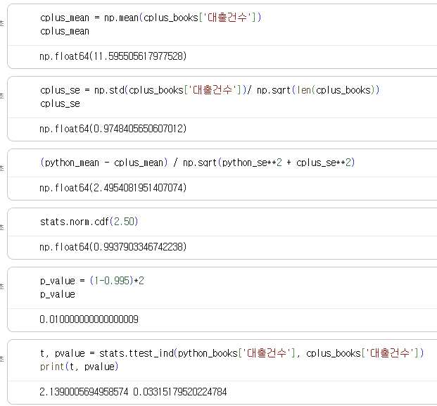
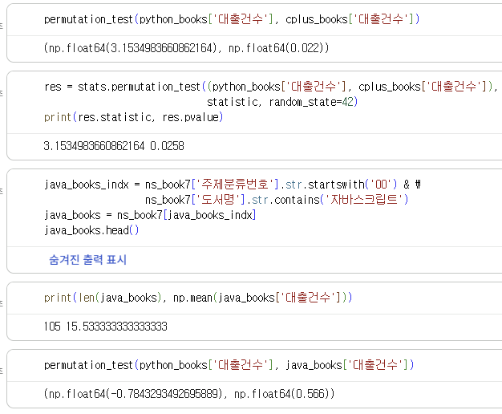
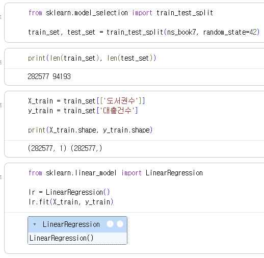
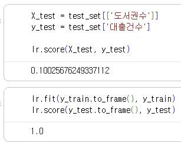
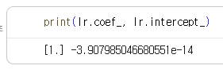
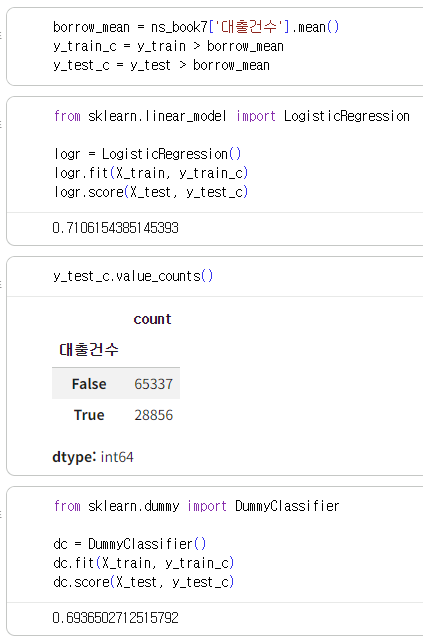
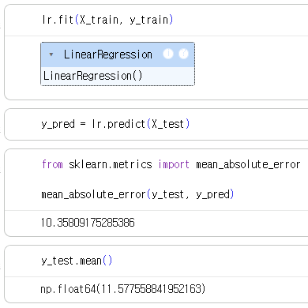

# 데이터분석 7주차 정규과제

📌데이터분석 정규과제는 매주 정해진 분량의 『*혼자 공부하는 데이터 분석 with 파이썬*』 을 읽고 학습하는 것입니다. 이번 주는 아래의 **DataAnalysis_7th_TIL**에 나열된 분량을 읽고 공부하시면 됩니다.

아래의 문제를 풀어보며 학습 내용을 점검하세요. 문제를 해결하는 과정에서 개념을 스스로 정리하고, 필요한 경우 제시된 강의를 참고하여 보완하는 것이 좋습니다.

<!-- 강의 링크는 아래와 같습니다.
https://www.youtube.com/watch?v=R3E4m8fqUSg&list=PLVsNizTWUw7FGzSRCkQrPEEe-ljVXgS7k&index=14
https://www.youtube.com/watch?v=W_cxRstQUk8&list=PLVsNizTWUw7FGzSRCkQrPEEe-ljVXgS7k&index=15
-->


## DataAnalysis_7th_TIL

### 7장 검증하고 예측하기
#### 01. 통계적으로 추론하기
#### 02. 머신러닝으로 예측하기


## Study Schedule

| 주차  | 공부 범위     | 완료 여부 |
| ----- | ------------- | --------- |
| 1주차 | p.24~81    | ✅         |
| 2주차 | p.84~151   | ✅         |
| 3주차 | p.154~219  | ✅         |
| 4주차 | p.222~279 | ✅         |
| 5주차 | p.282~325 | ✅         |
| 6주차 | p.328~379 | ✅         |
| 7주차 | p.382~430 | ✅         |

<br>

<!-- 여기까진 그대로 둬 주세요-->


# 1️⃣ 개념 정리 

## 01. 통계적으로 추론하기

통계적 추론은 모집단에서 표본을 뽑아 그 표본을 가지고 모집단의 어떤 성격을 검증하는 것으로, 전통적인 통계적 방법론이다. 

모수검정은 모집단이 있고, 거기서 샘플을 뽑아 모집단의 성격을 추정하는 것이다. 여기서 샘플은 머신러닝에서 말하는 '하나의 데이터 포인트'와는 다르게, 여러 데이터 포인트를 묶어서 추출한 집단 데이터셋을 의미한다. 
표준점수(Z-score)는 정규분포(평균을 중심으로 좌우대칭인 종 모양 분포)에서 어떤 데이터 포인트가 평균에서 얼마나 떨어져 있는지를 나타내는 값이다. 정규분포는 전체 데이터의 약 68%가 평균으로부터 ±1 표준편차 이내에 위치하고, 약 95%가 ±2 표준편차 이내에 위치한다. 평균이 0이고 표준편차가 1인 정규분포를 표준정규분포라고 한다. 

중심극한정리는 모집단이 정규분포를 따르지 않아도 그 모집단에서 무작위로 표본을 여러 번 뽑아 각 표본의 평균을 구하고, 그 평균들을 모아서 분포를 그려보면 정규분포를 따르게 된다는 것이다. 이렇게 얻은 표본 평균들의 평균은 모집단의 평균과 같고, 표준오차(표본 평균들의 표준편차)는 모집단의 표준편차를 표본 개수의 제곱근으로 나눈 값과 같다. 
현실에서는 표본을 무작위로 수천 번씩 반복해서 뽑기가 어렵기 때문에 표본을 딱 한 번만 뽑고, 그 하나의 표본으로 모집단의 평균을 추정할 때 중심극한정리를 활용한다.  

신뢰구간은 모집단의 평균이 표본 평균 기준으로 이 범위 안에 있을 것이라고 예상하는 구간이다. 가설검정은 영가설(H0)과 대립가설(Ha)을 놓고 어느 것이 맞을지 판단하는 것이다. 

순열검정은 모집단의 분포가 정규분포를 따르지 않거나 모집단의 분포를 알 수 없을 때 사용할 수 있는 방법이다. 두 표본을 하나로 합쳐 무작위로 다시 두 그룹으로 나누고(원래 표본 크기와 동일한 크기로), 두 그룹의 평균 차이를 계산한다. 이 과정을 여러 번 반복하여 원래 표본의 평균 차이가 무작위로 나뉜 그룹들의 평균 차이보다 크거나 작은 경우를 세어 p값을 계산한다. 표본만 있다면 평균 차이의 유의미성을 판단할 수 있다. 


## 02. 머신러닝으로 예측하기

머신러닝은 인공지능이라는 큰 범주 안에 속하는 기술/방법론 중 하나, 컴퓨터(프로그래밍)를 사용해서 데이터로부터 어떤 규칙이나 패턴을 학습하는 방법들이다. 
지도학습은 정답을 이미 알고 있는 경우에 사용하는 방법으로, 알고리즘에게 데이터와 그 데이터에 대한 정답을 알려주고 둘 사이의 상관관계 패턴을 학습하도록 훈련시키고, 훈련이 끝나면 정답이 없는 새로운 데이터를 입력했을 때 모델이 정답을 예측하는 방식이다. 
비지도학습은 정답(타깃)이 없는 경우에 사용하는 방법으로, 무언가를 예측하기보다는 주어진 데이터를 변환하거나 모으는 작업을 한다. 데이터의 특성(속성) 개수를 줄이는 것을 차원 축소, 비슷한 데이터끼리 모으는 것을 클러스터링이라고 한다. 

지도학습의 경우, 입력과 정답을 머신러닝 알고리즘에 전달하면 규칙(패턴)을 찾은 모델이 만들어진다. 이 모델에 입력만 전달하면 그 입력에 대한 타깃을 예측할 수 있다. 하지만 모델이 입력과 타깃 사이의 패턴을 찾지 않고, 그냥 타깃을 통째로 암기해버릴 수도 있어 데이터를 훈련용과 테스트용으로 나누어 사용한다. 훈련 세트로 먼저 모델을 훈련시키고, 테스트 세트를 모델에 넣어 예측한다. 이 예측값과 테스트 세트에 있는 실제 타깃을 비교해서, 두 값이 가까우면 모델이 잘 훈련되어 새로운 데이터에서도 예측을 잘 할 것이라고 예상할 수 있다. 

회귀라는 작업은 대체로 어떤 숫자를 예측하는 것이고, 분류라는 알고리즘은 정해진 몇 개의 카테고리를 예측하는 것이다. 
선형회귀는 선형 방정식을 사용해서 예측하는 것으로, 입력(x)과 타깃(y)을 알고리즘에 전달하고 선형 방정식을 구성하는 기울기(a)와 절편(b)을 찾도록 한다. 예측이 타깃과 똑같으면 R² 값은 1, 예측이 타깃의 평균 정도밖에 안 되면 R² 값은 0으로, 1에 가까울수록 모델이 타깃을 잘 예측한다고 볼 수 있다. 

로지스틱 회귀는 분류 모델이다. 선형 함수의 결과값을 0과 1 사이의 값으로 압축한다. 로지스틱 함수의 출력값이 0.5보다 크면 양성 클래스, 0.5보다 작으면 음성 클래스라고 한다. 분류 모델에서는 정확도로 훈련이 잘 되었는지 판단한다. 


# 2️⃣ 수행 인증










<br>
<br>

# 3️⃣ 확인 문제

## 문제 1.

> **🧚Q. 어떤 표본의 크기가 충분히 크고(n ≥ 30), 모집단 분산을 알 수 없을 때 모평균에 대한 신뢰구간을 구하려고 한다.
이때 다음 설명 중 가장 적절한 것은 무엇인가?**

```
1️⃣ 표본의 크기가 충분히 크므로 중심극한정리에 의해 표본평균의 분포는 근사적으로 정규분포를 따른다.  
2️⃣ 모집단 분산을 모르므로 신뢰구간을 구할 수 없다.  
3️⃣ 표본이 30개 이상이면 항상 모집단도 정규분포를 따른다.  
4️⃣ 중심극한정리는 모집단이 정규분포일 때만 적용된다.
```

```
정답 : 1

2. 모분산을 몰라도 표본분산으로 신뢰구간을 구할 수 있다
3. 표본평균의 분포가 정규분포에 가까워진다
4. 모집단이 정규분포가 아니어도 n이 충분히 크면 표본평균은 정규분포를 따른다
```

## 문제 2.

> **🧚Q. 다음 중 순열검정(permutation test)에 대한 설명으로 가장 옳은 것은 무엇인가?**

```
1️⃣ 모집단이 정규분포를 따른다는 가정을 반드시 해야 한다.  
2️⃣ 표준점수(z-score)를 이용하여 유의확률을 계산하는 방법이다.  
3️⃣ 데이터의 라벨을 무작위로 섞어 귀무가설 하에서의 분포를 직접 구성하는 비모수적 검정 방법이다.  
4️⃣ 표본의 크기가 충분히 클 때만 사용할 수 있다.
```

```
정답 : 3

1. 순열검정은 정규분포 가정이 필요 없다
2. z-score로 계산하는 것은 z-test이다
4. 표본이 작아서 정규근사를 믿기 어려운 상황에서도 사용할 수 있다
```


### 🎉 수고하셨습니다.