# SQL_ADVANCED 6주차 정규 과제 

📌SQL_ADVANCED 정규과제는 매주 정해진 분량의 『*혼자 공부하는 SQL*』 을 읽고 학습하는 것입니다. 이번주는 아래의 **SQL_ADVANCED_6th_TIL**에 나열된 분량을 읽고 공부하시면 됩니다.

아래의 문제를 풀어보며 학습 내용을 점검하세요. 문제를 해결하는 과정에서 개념을 스스로 정리하고, 필요한 경우 제시된 강의를 참고하여 보완하는 것이 좋습니다.

<!-- 강의 링크는 아래와 같습니다.
https://www.youtube.com/watch?v=cw1wGN0ZdFA&list=PLVsNizTWUw7GCfy5RH27cQL5MeKYnl8Pm&index=19
https://www.youtube.com/watch?v=bMQ_dAoaMzA&list=PLVsNizTWUw7GCfy5RH27cQL5MeKYnl8Pm&index=20
https://www.youtube.com/watch?v=bggWVsBmKag&list=PLVsNizTWUw7GCfy5RH27cQL5MeKYnl8Pm&index=21
-->

**교재 실습 예제 파일은 08_SQL_ADVANCED_Template 레포지토리의 src 폴더에 업로드되어 있습니다. market_db 파일도 해당 폴더에 함께 포함되어 있으니 참고하시기 바랍니다.**

**👀(수행 인증샷은 필수입니다.)** 

## SQL_ADVANCED_6th_TIL

### 7장 스토어드 프로시저
#### 01. 스토어드 프로시저 사용 방법
#### 02. 스토어드 함수와 커서
#### 03. 자동 실행되는 트리거 

## Study Schedule

| 주차  | 공부 범위     | 완료 여부 |
| ----- | ------------- | --------- |
| 1주차 | p.24~99    | ✅         |
| 2주차 | p.102~155   | ✅         |
| 3주차 | p.158~213  | ✅         |
| 4주차 | p.216~271 | ✅         |
| 5주차 | p.274~327 | ✅         |
| 6주차 | p.330~369 | ✅         |
| 7주차 | p.372~407 | 🍽️         |

 

<!-- 여기까진 그대로 둬 주세요-->

---

# 1️⃣ 학습 내용 정리

## 1. 스토어드 프로시저 사용 방법 

스토어드 프로시저는 SQL에 프로그래밍 기능이 합쳐진 것이다. C, Java, python 같은 일반 프로그래밍 언어와는 차이가 있지만 큰 흐름에서는 비슷하게 프로그래밍 기능을 제공한다. 

프로시저를 '만드는 것'과 '실행(호출)하는 것'은 서로 다른 것이다. 커피 자판기를 만든다고 자동으로 커피가 나오는 게 아니라 실제로 자판기를 작동시켜야만 커피가 나오는 것과 같다. 

CREATE PROCEDURE로 프로시저를 만들고 CALL로 호출한다. 한 번 만들어두면 필요할 때마다 실행해서 사용할 수 있다. DROP PROCEDURE로 프로시저를 삭제할 수 있다. 

입력 매개변수는 프로시저를 실행할 때 값을 전달하는 것, 자판기에 동전을 넣거나 버튼을 누르는 것이다. 출력 매개변수는 프로시저 실행 결과를 돌려받는 것, 빈 컵을 넣어서 커피가 채워진 컵을 받아오는 것이다. SELECT @변수명 으로 결과를 확인할 수 있다. 프로시저를 만드는 시점에는 그 안에서 사용하는 테이블이 존재하지 않아도 되고, 프로시저를 실행하는 시점에만 존재하면 된다. 

IF ~ ELSE문은 조건에 따라 다른 결과를 출력하는 조건문으로, 일반적인 프로그래밍 언어의 조건문과 동일한 개념을 저장 프로시저 안에서 그대로 사용할 수 있다. WHILE문은 반복문으로, 특정 조건을 만족하는 동안 반복해서 작업을 수행하는 구문이다. 동적 SQL은 SQL문이 고정되어 있지 않고 테이블 이름을 넘겨받아서 실행 시점에 동적으로 SQL문이 만들어지고 바뀌는 것이다. 

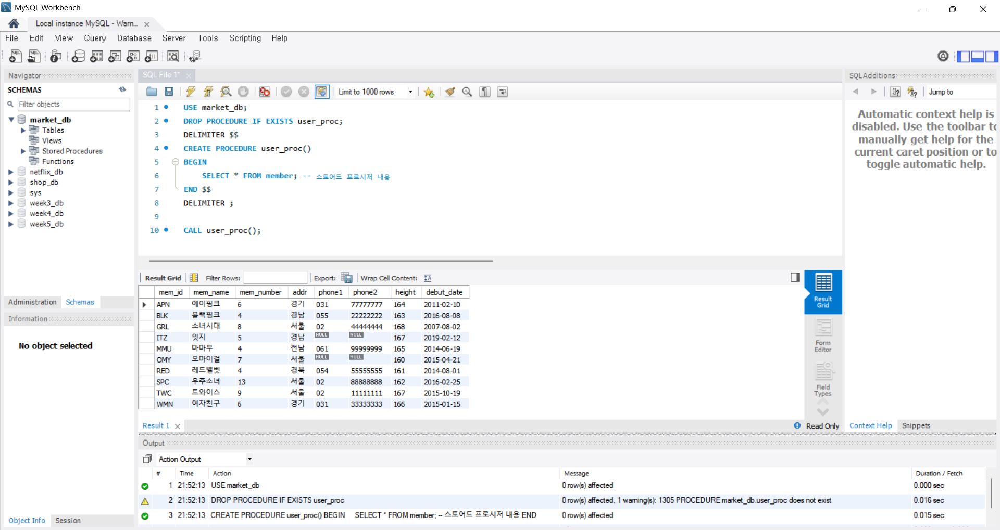
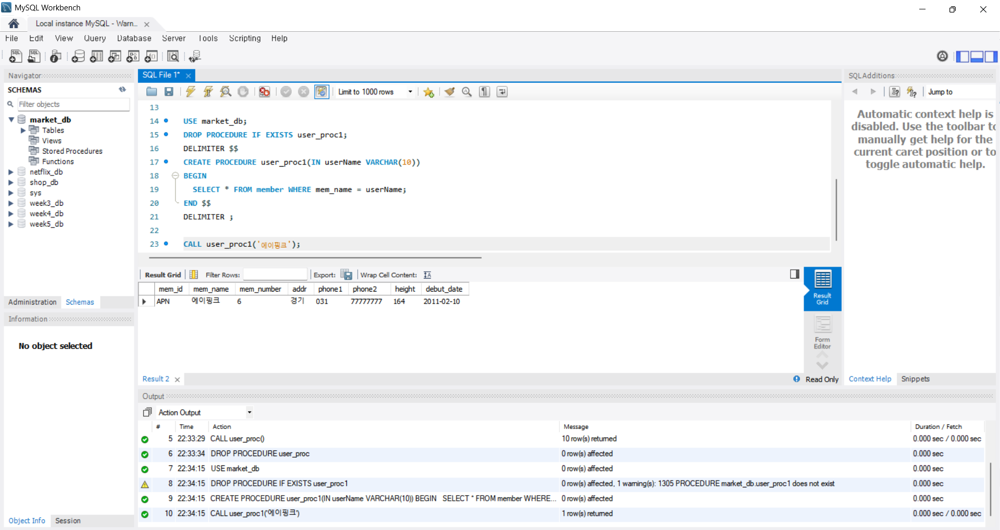
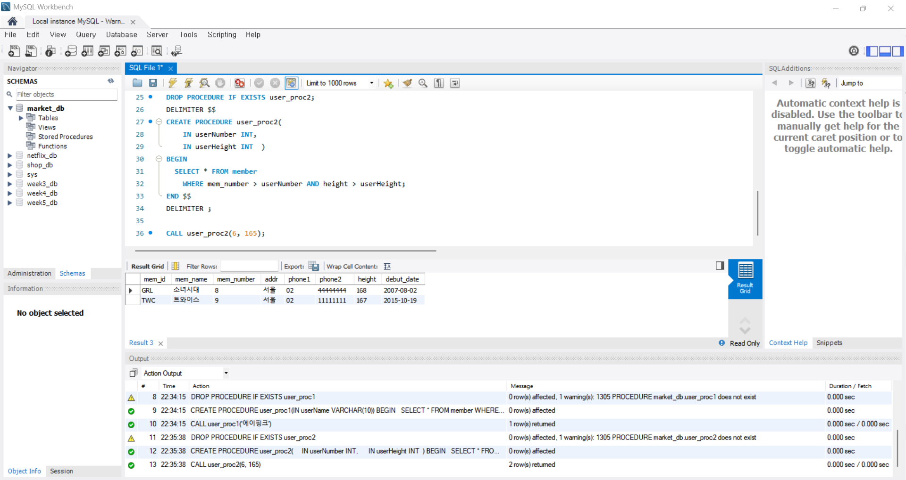
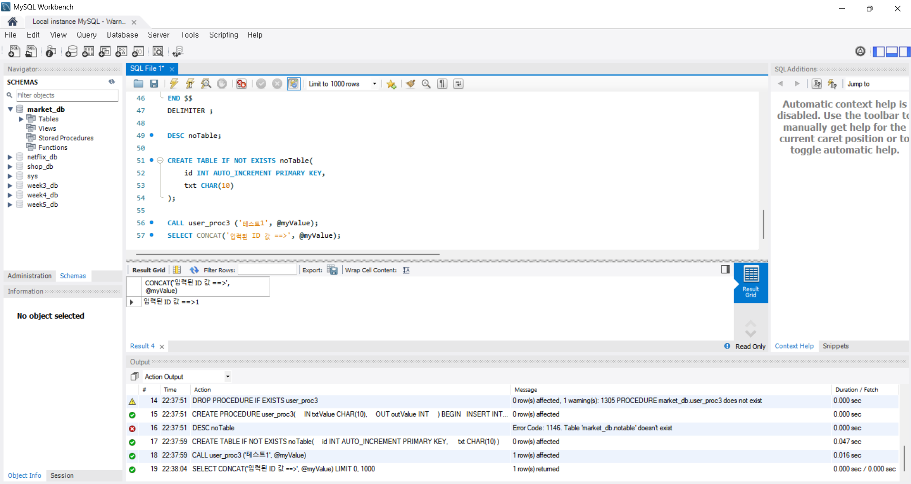
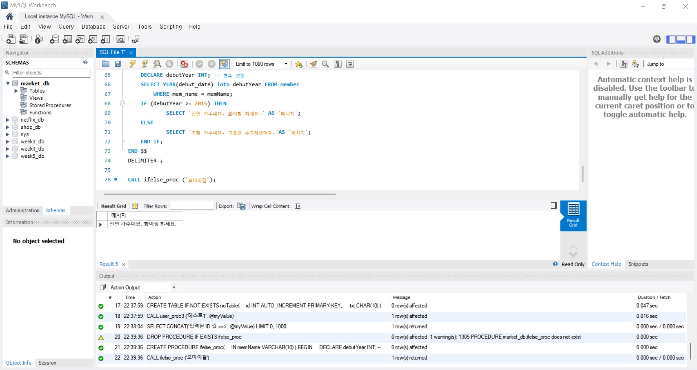
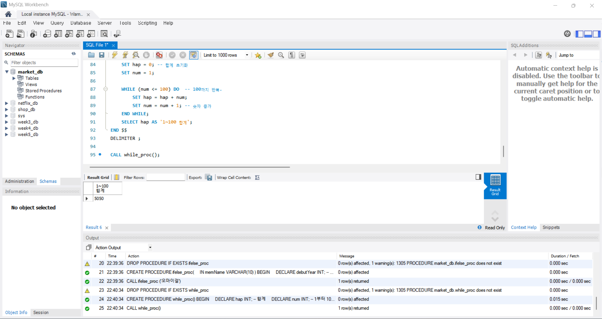
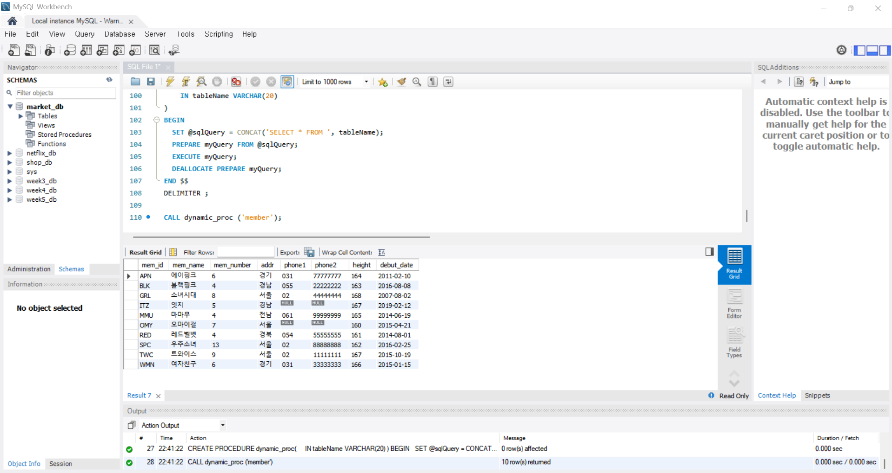

## 2. 스토어드 함수와 커서 

스토어드 함수는 MySQL이 제공하는 함수 외의 내가 직접 필요한 함수를 만들 수 있는 것이다. 스토어드 프로시저와 형태는 비슷하지만 용도가 다르다. RETURNS로 반환 형식을 지정하고 반환한다. 프로시저는 CALL로 호출하지만, 함수는 CALL을 쓰지 않고 SELECT문 내부에서 함수 이름을 사용해서 실행한다. 함수는 테이블 조회 결과에 적용해서 쿼리 결과에서 바로 계산된 값을 출력하는 방식으로 사용된다. 

커서는 한 행씩 순차적으로 처리하는 개념이다. 여러 행이 있을 때 한 건씩 차례로 처리하기 위해 사용한다. 한 번에 함수로 구할 수 있는 것도, 커서를 활용하여 한 건씩 처리하는 방식으로도 구현할 수 있다. 

사용할 변수 준비하기: 계산에 필요한 변수들을 준비하고 디폴트를 지정
커서 선언하기: 어떤 데이터를 대상으로 할지 SELECT문으로 지정
반복 조건 선언하기: 행의 끝에 도달했을 때를 체크하는 반복 조건
커서 열기: 준비한 커서를 오픈
행 반복하기: 행을 반복하다가 행의 끝에 도달하면 반복에서 빠져나가는 조건 생성
커서 닫기: 모든 작업이 끝나면 커서 닫음

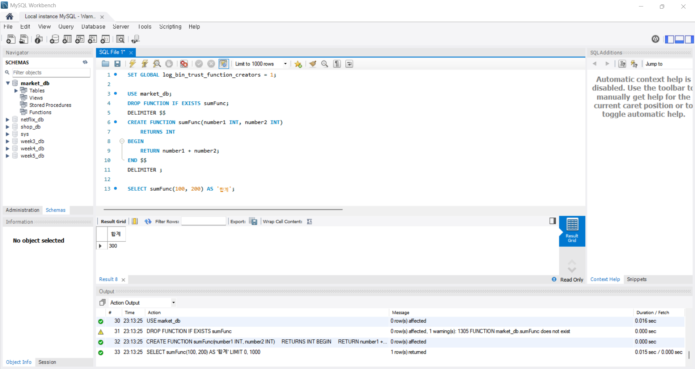
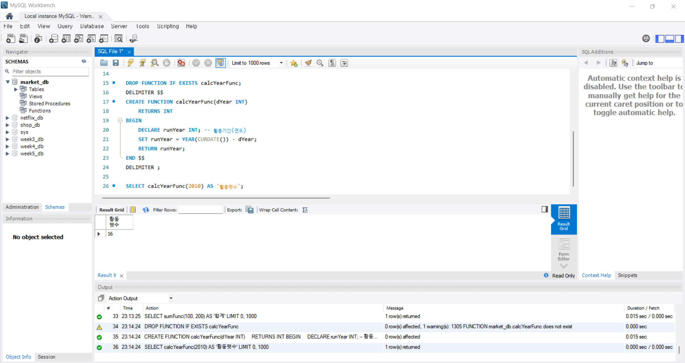
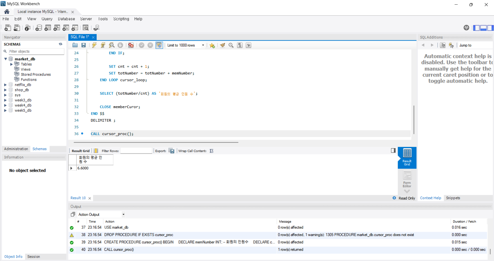

## 3. 자동 실행되는 트리거 

트리거는 테이블에 INSERT, UPDATE, DELETE 같은 작업(SELECT는 대상 아님)이 실행되면 자동으로 쿼리가 실행되는 것이다. 데이터를 삭제하기 전에 다른 곳에 옮겨놓으면 되지만 이걸 매번 수동으로 하면 빠뜨리면 데이터의 무결성이 깨져 결함 있는 데이터가 된다. 그래서 삭제가 일어날 때 자동으로 다른 곳에 저장해주는 용도로 사용한다. 

테이블에 INSERT, UPDATE, DELETE 같은 이벤트가 발생하면 그 테이블에 부착된 트리거가 자동으로 작동한다. 스토어드 프로시저와 비슷하지만 매개변수 개념이 없고, 따로 실행할 수 없다. 

트리거 활용 - 데이터 백업
중요한 정보가 수정되거나 삭제될 때 누가 언제 어떤 작업을 했는지 기록을 남기기 위해 트리거를 사용한다. 수정이나 삭제가 일어나기 전에 변경되기 전의 데이터를 백업 테이블에 자동으로 저장하도록 구성한다. UPDATE나 DELETE가 수행될 때 변경되기 전의 데이터가 잠깐 임시 테이블에 저장되고, 트리거 안에서 OLD.열이름으로 참조하면 이전의 데이터 값을 가져올 수 있다.
TRUNCATE TABLE은 테이블의 모든 데이터를 한 번에 삭제하는 것이다. 하지만 TRUNCATE는 DELETE 문이 아니기 때문에 DELETE 트리거를 작동시키지 않아 백업이 되지 않는다. 

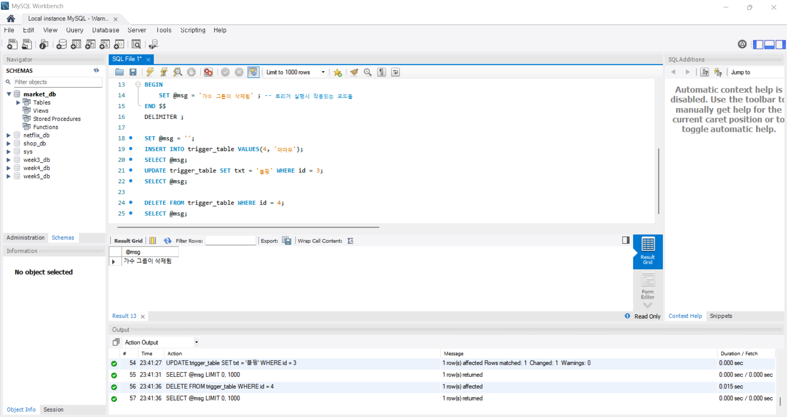
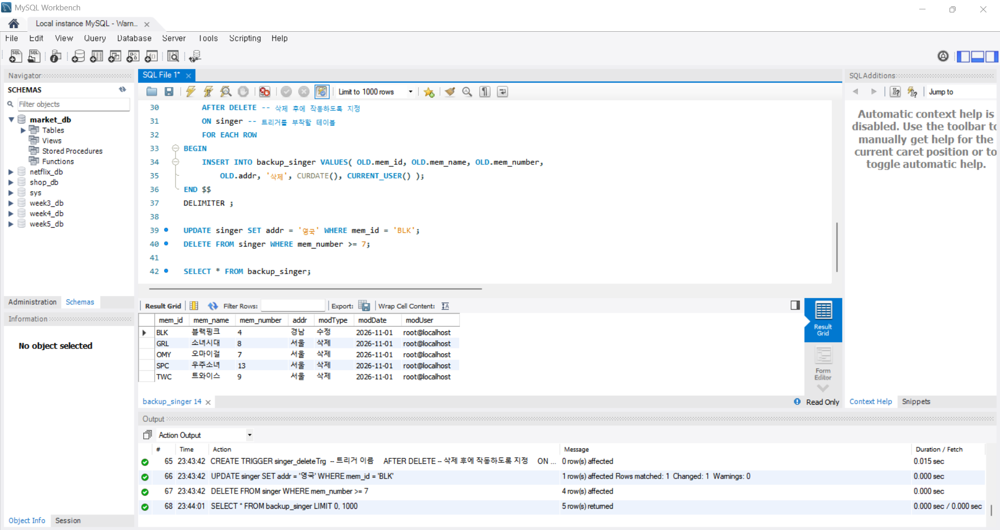
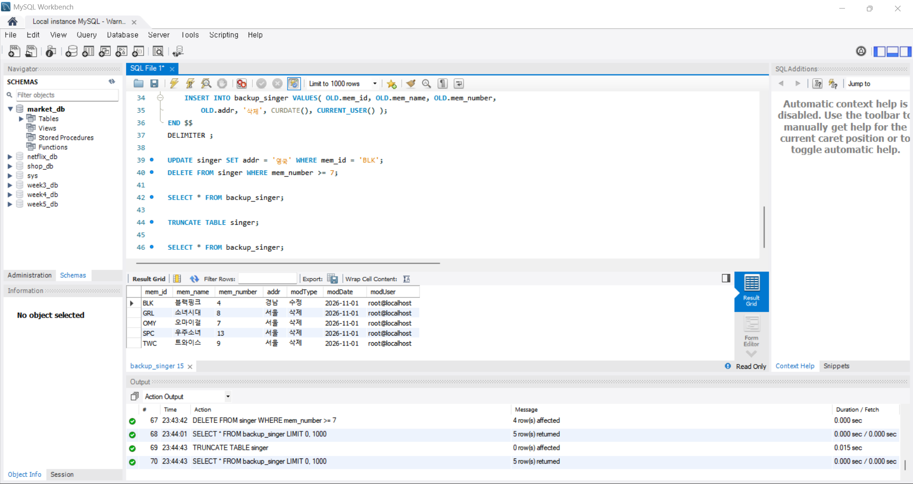

---

### 🎉 수고하셨습니다.